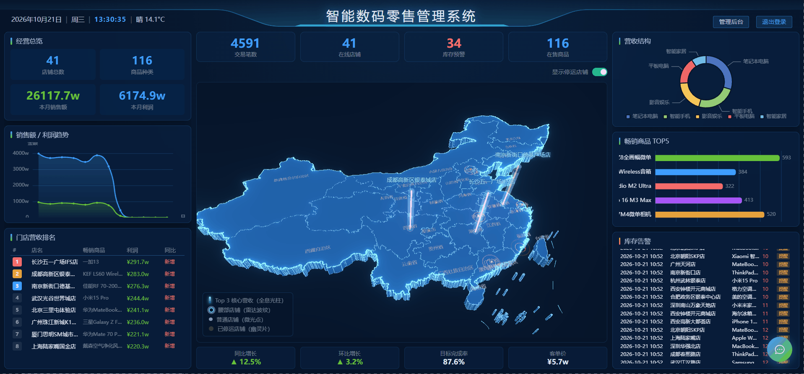
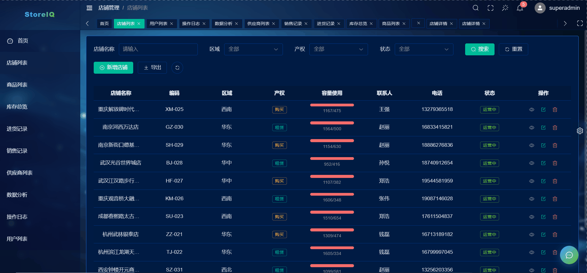
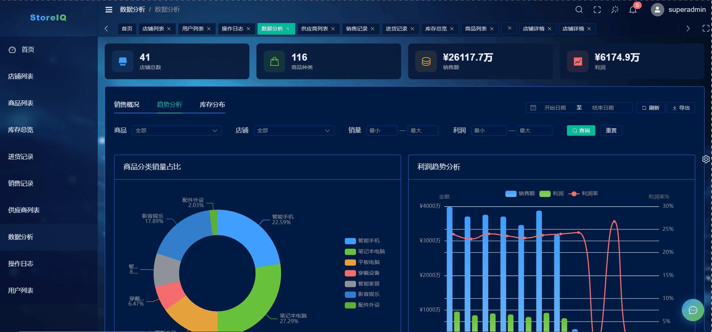
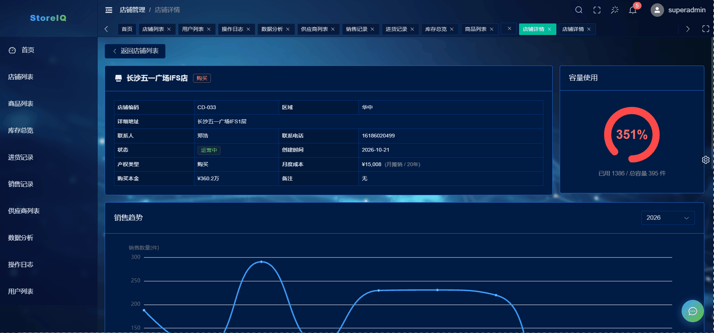

<div align="center">

# StoreIQ · 智能数码零售管理系统

**Vue3 + Three.js 3D 数据大屏 · Spring Boot 后端 · 全栈进销存与经营分析**

[](https://vuejs.org)
[](https://threejs.org)
[](https://spring.io)
[](https://baomidou.com)
[](https://echarts.apache.org)
[](https://www.mysql.com)

**English Abstract**：StoreIQ is a full-stack digital-retail management system with a **real-time 3D dashboard** — a Three.js rendered 3D map of China where each store is a glowing pillar (animated cyberpunk light-bands for active stores, dimmed static pillars for closed ones), plus complete modules for stores, products, inventory, purchases, sales, suppliers, users, operation logs and an AI business assistant. Built with Vue 3 + Element Plus on the frontend and Spring Boot + MyBatis-Plus on the backend.

[🎥 效果演示](#-效果演示) · [✨ 功能特性](#-功能特性) · [🚀 快速开始](#-快速开始) · [📁 项目结构](#-项目结构)

</div>

## 🎥 效果演示

> GIF 演示图（替换为你的录屏，建议 15~20 秒：大屏加载 → 旋转缩放 → 悬停店铺信息卡 → 流动光带特写）



## ✨ 功能特性

### 🗺️ 3D 数据大屏（首页 /map）
- **Three.js 3D 中国地图**：省份板块挤出建模、国界流光轮廓、Bloom 泛光后处理、CSS2D 店铺标签
- **店铺利润光柱**：利润映射柱高，**运营中店铺柱体带赛博朋克螺旋光带流动效果，停运店铺静止变暗**，一眼区分营业状态
- 库存预警警示环动画、悬停信息卡（利润/库存/营业状态）、双击固定、省份悬停高亮
- 经营总览、销售/利润趋势、门店营收排名、营收结构、畅销商品 TOP5、库存告警滚动榜
- 深度性能优化：渲染循环 rAF 节流、GPU 资源全量释放、mousemove 拾取节流、时钟组件隔离

### 🛍️ 业务管理后台
- **店铺管理**：Leaflet + OSM 地图选点（点击/拖拽/地址搜索定位，离线瓦片一键下载脚本）、联系人关联系统用户
- **商品 / 分类 / 供应商管理**：SKU 档案、分类树、供应商档案
- **库存管理**：只读总览 + 预警横幅 + 多条件筛选
- **进货管理**：入库联动库存、批量导入 Excel、记录查询
- **销售管理**：出库弹窗（选店铺 → 按店铺过滤商品 → 实时库存显示 → 0 库存拦截）、扫码录入、批量导入、预估利润
- **数据分析**：销售概况 / 趋势分析 / 库存分布三 Tab
- **操作日志**：AOP 自动记录业务变更，生成人类可读详情（如「店铺『总店』出库商品『iPhone 15』× 2」）
- **AI 经营助手**：自动补货建议、爆款分析、利润优化等
- 用户/角色/权限（RBAC）、灰色模式/色弱模式、多主题切换

## 🛠 技术栈

| 端 | 技术 |
|---|---|
| 前端 | Vue 3.5（Composition API + `<script setup>`）· Vite · Element Plus · Pinia · Vue Router |
| 3D/图表 | Three.js（EffectComposer/Bloom、Line2 流光、CSS2DRenderer、TWEEN）· ECharts 5 · Leaflet |
| 后端 | Spring Boot 2 · MyBatis-Plus 3.5（自动填充/分页）· Spring AOP（操作日志）· JWT 鉴权 · Knife4j |
| 数据库 | MySQL 8（含一键初始化 + 演示数据 SQL） |

## 🚀 快速开始

### 0. 环境要求
- Node.js ≥ 18、JDK ≥ 8（建议 11+）、Maven、MySQL 8

### 1. 初始化数据库
```bash
mysql -u root -p < sql/storeiq-init.sql    # 建库建表 + 基础数据
mysql -u root -p < sql/storeiq-seed.sql    # 演示数据（店铺/商品/销售记录等）
```

### 2. 启动后端（端口 8002）
```bash
cd backend/storeiq-api
# 设置环境变量（必填，代码中不包含任何密钥）
#   Windows(CMD):  set DB_PASSWORD=你的MySQL密码 && set JWT_SECRET=随机字符串(≥32位)
#   IDEA: Run Configuration → Environment variables 填写 DB_PASSWORD=xxx;JWT_SECRET=xxx
mvn spring-boot:run
```
接口文档：http://localhost:8002/doc.html （Knife4j）

### 3. 启动前端
```bash
cd frontend/storeiq-web
npm install
npm run dev    # http://localhost:5173（已配置代理到 8002）
```

### 4. 默认账号
| 账号 | 角色 | 说明 |
|---|---|---|
| superadmin /（默认密码见 `sql/storeiq-init.sql`） | 超级管理员 | **部署前务必修改** |

### 5. Docker 一键部署（推荐用于生产）

```bash
cp .env.example .env   # 填写 DB_PASSWORD / JWT_SECRET
docker compose up -d --build   # 一键启动 MySQL + 后端 + 前端(Nginx 同源反代)
```
访问 `http://服务器IP`（本地预览若 80 被占用改为 `8080:80`）。含阿里云学生机完整部署流程（安全组/镜像加速/HTTPS），详见 [docs/DEPLOY.md](docs/DEPLOY.md)。

### 6. 离线地图瓦片（可选）
大屏地图默认使用高德在线瓦片（国内可用）；如需完全离线，可下载瓦片到本地：
```bash
cd frontend/storeiq-web
node scripts/download-tiles.mjs                    # 全国 zoom 4~8（约 13MB）
node scripts/download-tiles.mjs --minLat 30.6 --maxLat 31.5 --minLon 120.8 --maxLon 122.2 --maxZoom 15  # 单城市高精度
```

## 📁 项目结构

```
StoreIQ
├── backend/storeiq-api        # Spring Boot 后端
│   └── src/main/java/com/storeiq
│       ├── controller/        # 15 个业务控制器
│       ├── common/            # JWT、AOP 操作日志、自动填充、全局异常
│       ├── entity/ mapper/ service/ dto/ task/
│       └── resources/application.yml
├── frontend/storeiq-web       # Vue3 前端
│   ├── src/pages/map/         # 3D 数据大屏（Three.js 核心）
│   ├── src/pages/{store,product,inventory,purchase,sale,supplier,analytics,log,user}/
│   ├── src/common/            # 通用组件（地图选点 MapPicker 等）、API、工具
│   └── scripts/download-tiles.mjs   # 离线瓦片下载脚本
└── sql/                       # 建库建表 + 演示数据
```

## 🖼 更多演示

> 后台管理系统实机演示（如与文件不对应，可自行调整文件名与说明）

| 店铺管理（地图选点） | 销售管理（出库联动库存） | 数据分析 |
|---|---|---|
|  |  |  |

## 📄 License

[MIT](LICENSE) © 2026 San-he
